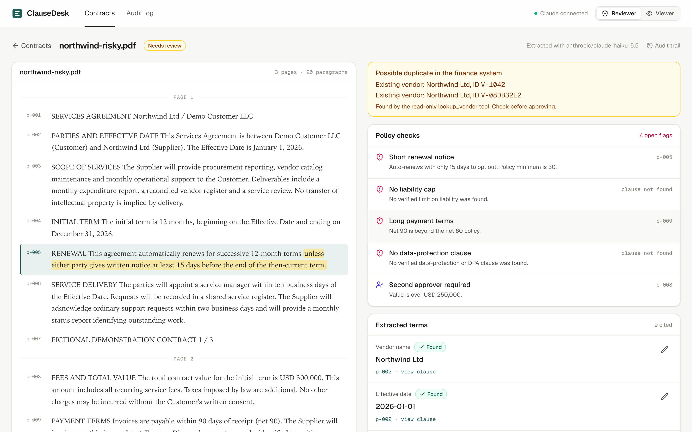
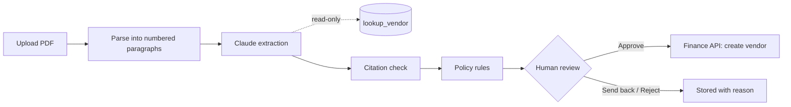

# ClauseDesk

Contract intake for procurement and finance teams. Upload a vendor contract and ClauseDesk extracts the key commercial terms, cites the paragraph each one came from, checks those citations, flags policy risks, and waits for a person to approve before anything is created in the finance system.

**Live demo:** [clausedesk-nine.vercel.app](https://clausedesk-nine.vercel.app). Open a sample contract from the home page. No sign-in needed.



## What it does

1. **Parse.** The PDF is converted to text and split into numbered paragraphs (`p-001`, `p-002`, …) with page numbers.
2. **Extract.** Claude reads the paragraphs and returns 11 fields: vendor, effective date, initial term, auto-renewal, renewal notice, payment terms, total value, termination for convenience, liability cap, governing law and data protection. Each found field comes with a paragraph ID and a verbatim quote. A field the contract doesn't state comes back as `not_found` rather than as a guess.
3. **Check citations.** Code checks that each quote appears word for word in the paragraph it cites. A field that fails is marked *Unsupported*, shown to the reviewer with the reason, and treated as missing by the rules.
4. **Flag.** Deterministic rules, not the model, raise the policy flags:
   - renewal notice under 30 days, or auto-renewal with no stated notice period
   - no verified liability cap
   - payment terms longer than net 60
   - no data-protection clause
   - a second approver for contracts over USD 250,000
5. **Review.** A reviewer reads each term next to its highlighted source, corrects values if needed, and then approves, sends back or rejects. A reason is required whenever flags are open, and approval is blocked while any field is unsupported.
6. **Hand off.** On approval, the server creates the vendor in the finance system (a mock API at `/api/erp/vendors` in this demo).

Progress streams to the screen as it happens: *Parsing → Extracting → Checking citations → Flags ready*. The audit log records every upload, extraction, vendor lookup, field edit, decision and finance API call.

## How it works



Built with Next.js (App Router), TypeScript, Tailwind, the Anthropic SDK, `unpdf` for PDF text, Drizzle on Neon Postgres, and Zod for validating every API request and model response.

## Guardrails

- **The model cannot create or change anything.** It has one tool, `lookup_vendor`, which only reads. It uses it to check whether the vendor already exists in the finance system. Only the server creates records, and only after a person approves.
- **The finance write needs an approval.** `POST /api/erp/vendors` requires the Reviewer role, an `Idempotency-Key` header and the ID of a stored approval. One approval creates at most one vendor, and a retry returns the original record instead of a duplicate.
- **Every answer needs evidence.** Quotes are matched against the cited paragraph, ignoring only whitespace. A paraphrased, invented or misattributed quote is rejected.
- **The rules are code.** Flags come from fixed thresholds applied to verified fields, so the same contract always gets the same flags.
- **Contract text is untrusted.** The model is told the document is data, not instructions. Its output must pass a strict schema with no extra keys, and it gets at most one tool round-trip.
- **Roles are enforced on the server.** Viewers can read everything but every write endpoint returns 403 for them, not only the disabled buttons.
- **Edits are tracked.** A reviewer's correction is saved alongside the original extraction, with old and new values in the audit log. Saves are versioned, so two reviewers can't overwrite each other.
- **Limits.** Uploads are capped at 10 MB and 150 pages. Upload and extraction are rate limited per client and globally. The API key stays on the server.
- **Web hardening.** Writes from other origins are refused, the role cookie is `httpOnly` and `SameSite=Strict`, large uploads go to private Blob storage, and every page is served with headers that block framing and MIME sniffing.

## Evaluation

`npm run eval` runs the extractor over 14 labelled contracts: 8 public agreements from CUAD and 6 fictional demo contracts. Each contract has 11 fields, 154 in total. For 53 of them the correct answer is "not stated".

| | Claude Haiku 5.5 | Pattern baseline |
| --- | --- | --- |
| Field accuracy | **147 / 154 (95.4%)** | 78 / 154 (50.6%) |
| Fields present in the contract | 94 / 101 (93.0%) | 25 / 101 (24.7%) |
| Correctly returned `not_found` | 53 / 53 (100%) | 53 / 53 (100%) |
| Citations rejected by the check | 0 of 96 | 0 of 25 |

The baseline is the offline regex extractor the app falls back to without an API key (`npm run eval:baseline`). Percentages are truncated, not rounded. The Haiku run cost about $0.03 for all 14 contracts through OpenRouter.

All seven misses are on CUAD contracts. On three contracts where renewal requires both parties to agree, the model returned "not found" for auto-renewal instead of "no". On two contracts it also missed the effective date. Twice it gave a wrong value: "12 months" for a term written as a date range, and a liability cap with the right meaning but different wording, which the text matcher counts as wrong.

The labels were written for this project from the contract text and have not been reviewed by a lawyer. Fourteen contracts are enough to catch regressions, not to make claims about accuracy in general. Per-contract results are in `evals/results/`.

## Run locally

Requires Node 20 or later.

```bash
npm install
cp .env.example .env.local   # add a model key and, optionally, DATABASE_URL
npm run db:push              # only if DATABASE_URL is set
npm run dev
```

| Variable | Purpose |
| --- | --- |
| `OPENROUTER_API_KEY` or `ANTHROPIC_API_KEY` | Model access. Without either, the app runs with the offline pattern extractor and says so in the header. |
| `ANTHROPIC_MODEL` | Optional model override, e.g. `anthropic/claude-haiku-5.5` on OpenRouter. |
| `DATABASE_URL` | Postgres (Neon). If unset, local development uses an embedded database in `.local/db`, so nothing else needs installing. |
| `BLOB_READ_WRITE_TOKEN` | Optional. Vercel Blob, only needed for uploads over 4 MB when deployed. |

Other commands: `npm test` (unit and API tests, no network), `npm run eval`, `npm run eval:baseline`, `npm run typecheck`, and `npm run samples` (regenerates the demo PDFs from `scripts/contracts/`).

## Data and credits

The public contracts in `samples/cuad-*.pdf` come from the [Contract Understanding Atticus Dataset (CUAD) v1](https://www.atticusprojectai.org/cuad) by The Atticus Project, licensed under [CC BY 4.0](https://creativecommons.org/licenses/by/4.0/). Source URLs and checksums are in `samples/cuad-manifest.json`. The other sample contracts are fictional and marked as such on every page.

## Known limits and next steps

- **Scanned PDFs.** There is no OCR yet, so image-only PDFs are rejected with a clear message. Next step: OCR before parsing.
- **Second approver.** Contracts over USD 250,000 are flagged for a second approver, but the workflow doesn't enforce it yet. Next step: a separate approval step from a different user.
- **Authentication.** The Reviewer/Viewer switch is a demo stand-in; the server enforces it, but anyone can pick either role. Next step: SSO, with roles from the identity provider.
- **The demo is public.** There is a single shared workspace, so anything uploaded is visible to every visitor. Don't upload confidential contracts to it.
- **Rate limiting** is in memory per server instance. A shared store such as Redis would make it exact across instances.
- **Field coverage** is the 11 fields above. Indemnities, SLAs and price escalation would be natural additions, with labels to match.

## License

MIT for the code. CUAD documents remain under CC BY 4.0.
